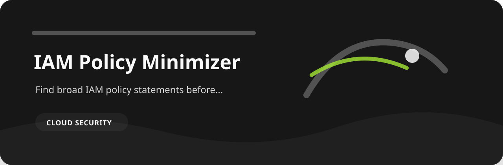

# Iam Policy Minimizer



Find broad IAM policy statements before cloud access is merged.

`Python`

## Start here

```bash
git clone https://github.com/mertefekurt/iam-policy-minimizer.git
cd iam-policy-minimizer
python -m pip install -e ".[dev]"
iam-policy-minimizer examples/sample.txt
```

## Repository

[Open the source on GitHub →](https://github.com/mertefekurt/iam-policy-minimizer)

[MIT License](LICENSE)
